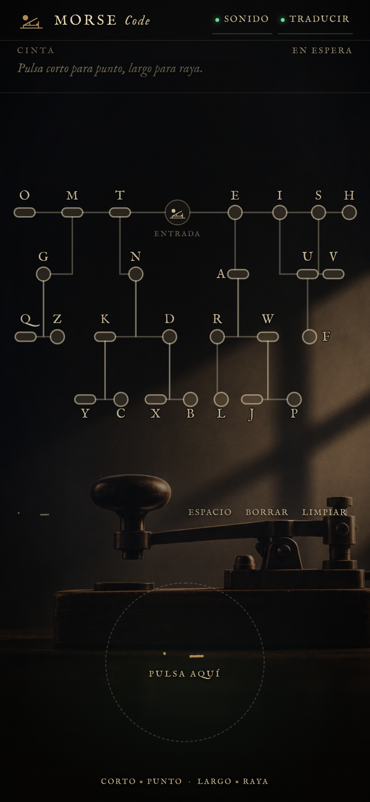

# Morse — telegrafista mobile first



Web app para móvil que simula una tecla de telégrafo morse e incluye el **grafo del código morse** para consultar y seguir la ruta de cada letra:

- **Pulsación corta** → punto (`.`)
- **Pulsación larga** → raya (`-`)
- La tecla aparece **donde pones el dedo** dentro de la zona de pulsación.
- **Grafo morse** como una placa grabada: cada letra es su propio símbolo sobre el cableado (un **punto** o una **raya**) y la letra se dibuja al lado, nunca dentro del símbolo. La ruta que estás tecleando se ilumina en tiempo real y la letra en curso se marca en verde.
- **Toca una letra del grafo** para ver su ruta y su código sin escribirla (por ejemplo, `H · · · ·`). Tócala otra vez para quitar la vista previa.
- Traduce punto y raya a letras en pantalla y permite desactivar la traducción en tiempo real.
- Sonido de tono morse mientras mantienes pulsado, con duración mínima para que los toques rápidos suenen. El audio se corta en cuanto sueltas (y también si la app pierde el foco), así que nunca se queda pitando.
- Foto de un manipulador de telégrafo de fondo, con veladuras para que la interfaz siga siendo legible.
- Vibración opcional en dispositivos compatibles (Android).
- Pensada para instalarse como PWA (manifest e iconos incluidos).

## Cómo abrirla

Al ser HTML/CSS/JS sin build, basta con servir la carpeta con Node:

```bash
cd /Users/brainbracket/Proyectos/morse
npm install
npm start
```

Y abrir `http://localhost:8080` en el navegador. En el móvil, entra desde la IP de tu Mac en la misma red:

```text
http://192.168.x.x:8080
```

> También funciona abriendo `index.html` directamente, pero servida por HTTP se comporta mejor (manifest, instalación, caché).

## Cómo se usa

1. Mantén el móvil con una mano.
2. Pulsa en cualquier punto de la zona inferior: la tecla aparece bajo el dedo.
3. Suelta rápido para un **punto**; mantén más de **220 ms** para una **raya**.
4. Haz una pausa de **650 ms** para confirmar la letra y **1,5 s** para insertar un espacio.
5. Usa **Espacio / Borrar / Limpiar** para editar.
6. **Sonido** activa o desactiva el pitido. **Traducir** oculta el texto decodificado y deja solo los símbolos.

En el grafo:

- Cada letra se dibuja como un **punto** (círculo) o una **raya** (cápsula) sobre el cableado; la letra va fuera del símbolo, como en la placa de referencia.
- El cableado baja **recto** desde cada símbolo hasta la fila de la letra destino y allí gira en horizontal para entrar por el lado del símbolo; sin escalones ni quiebros a media altura.
- Mientras tecleas, se ilumina la ruta completa desde la entrada hasta la letra en curso.
- Al soltar y confirmar la letra, su ruta queda iluminada.
- Al tocar una letra (o su símbolo), se ilumina su ruta y su símbolo. El grafo incluye A–Z, Ä, Ö y Ü; los números y signos se siguen traduciendo en el mensaje.

En escritorio, la barra espaciadora funciona como tecla morse (mantener = raya).

## Detalles de implementación

| Archivo | Contenido | 
| --- | --- |
| `index.html` | Estructura de la interfaz, grafo y tecla. |
| `styles.css` | Diseño mobile first, safe areas, grafo y tecla que sigue al dedo. |
| `app.js` | Tabla morse, árbol SVG, temporización, Web Audio, punteros y estado. |
| `manifest.webmanifest` | Configuración PWA. |
| `icon*.png`, `icon.svg` | Iconos de app. |
| `preview.png` | Captura de referencia del diseño. |
| `fondo.jpg` | Foto de fondo (manipulador de telégrafo). |

El grafo se construye en `app.js` a partir de la tabla `MORSE` y se dibuja como SVG (niveles 1–4). Las conexiones se trazan con `edgeGeometry`: una bajada vertical desde el padre hasta la fila del hijo y un tramo horizontal a la altura de esa fila que entra por el lado del símbolo. La ruta activa se resuelve con los prefijos del código en curso, de modo que el resaltado siempre coincide con lo que se está tecleando.

Tiempos ajustables al principio de `app.js`:

```js
const LONG_PRESS_MS = 220;   // umbral punto/raya
const LETTER_GAP_MS = 650;   // pausa que confirma una letra
const WORD_EXTRA_MS = 850;   // pausa extra que inserta un espacio
const MIN_TONE_MS = 70;      // pitido mínimo para toques rápidos
const TONE_HZ = 600;         // frecuencia del tono
```

El sonido usa la **Web Audio API**: un único oscilador senoidal permanente conectado a una compuerta de ganancia silenciosa. Al pulsar se abre la compuerta y al soltar se cierra con una envolvente corta, de modo que ningún evento perdido puede dejar el tono sonando. Además hay cierres de seguridad en `pointerup`/`touchend`/`blur`/`pagehide` y un temporizador máximo de pulsación. El audio se desbloquea con el primer toque, como exigen iOS y Android.
